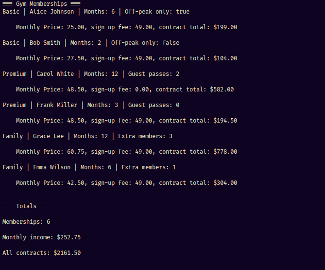
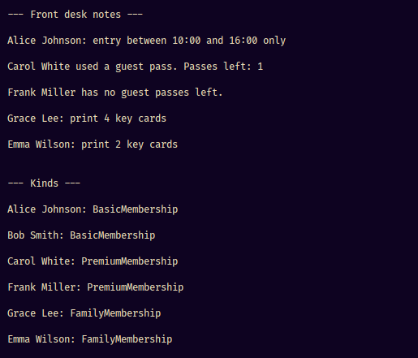

# Gym Memberships

A console program that displays the three different kinds of memberships offered by the gym.

## Description of the Project

The project is a Java console display for a gym that displays three membership options in the terminal so 
users see different memberships, check pricing, and compare plans. Users can see how the available tiers, features and 
costs differ. The outputs are straightforward and allow the user to see how the code is works.


## Features

- Shows details and pricing for each membership option
- Organized view with titles separating each part
- Shows how the code is working

## Setup

### Prerequisites

- Java 17 (Amazon Corretto), the version used in class.
- IntelliJ IDEA Community Edition: <https://www.jetbrains.com/idea/download/>

### Running the application

1. Clone this repository, or download it as a zip and unzip it.
2. In IntelliJ: File > Open, pick the project folder (the one that holds `pom.xml`), press Open.
3. Wait for IntelliJ to finish indexing (progress bar at the bottom).
4. Open `src/main/java/com/pluralsight/Main.java`. 
5. Right-click inside the file and choose Run 'Main.main()'.


## Technologies Used

- Java 17
- IntelliJ IDEA


## Demo





## A piece of code I am proud of

This piece of code gave me the hardest time because my mistake was so simple that I didnt even notice and had to ask Raymond for help. I had tried my code in the calculator many times and by all means it should have worked.
While it was frustrating, it also taught me something important which is parenthesis placement. I never realized just how big of a role parenthesis placement plays on the order of operations. I'm glad I know now.

```java
//get monthly price in FamilyMembership
  public BigDecimal getMonthlyPrice() {
       BigDecimal regularPrice = getBaseRate().add(new BigDecimal("12.50").multiply(new BigDecimal(getExtraMembers())));
        if (new BigDecimal(getExtraMembers()).compareTo(new BigDecimal("3"))>=0){
            BigDecimal newPrice;
            BigDecimal discount = regularPrice.divide(new BigDecimal("100")).multiply(new BigDecimal("10"));
            newPrice = regularPrice.subtract(discount);
            return newPrice.setScale(2, RoundingMode.HALF_UP);
        }
        return regularPrice;
    }
```

## Future Work

- The bonus. I'll try to do it if I have time before 8:30 am.
- 

## Resources

- Java YearUp Fall 2026 hub: <https://raymaroun.github.io/yearup-java-fall2026/>
- W3 Schools
- Visual hub (for the diagram)

## Author

- **Amanda Charles**

## Thanks


- Thank you to Ray for answering my questions and giving me an outside perspective of my code.
